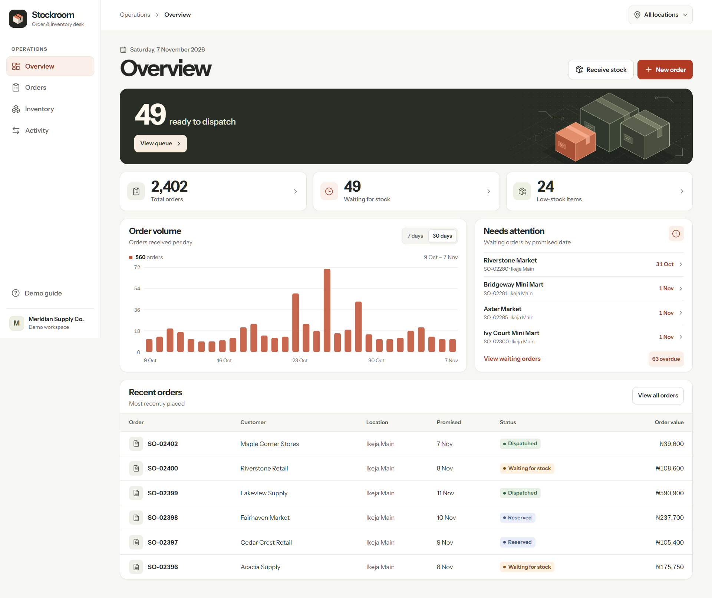
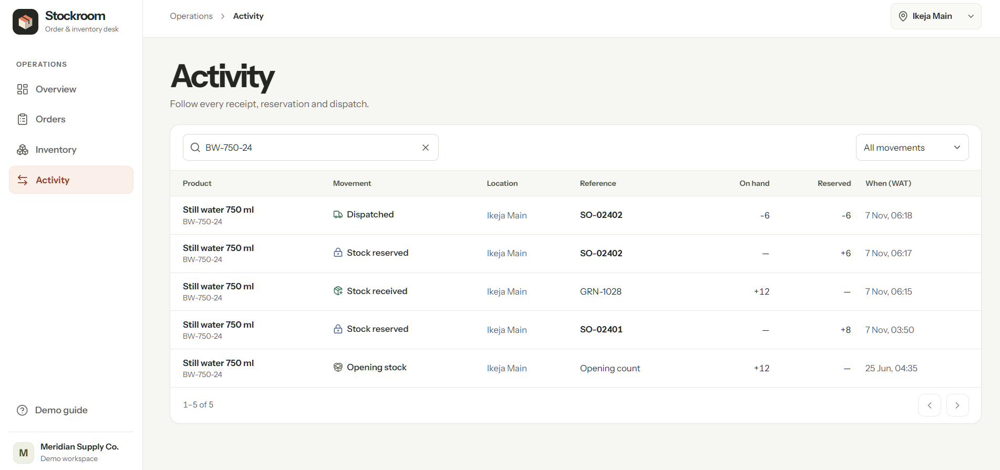
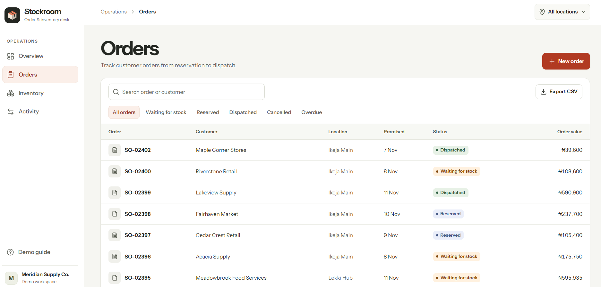
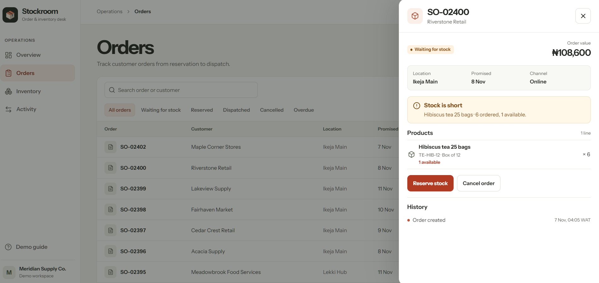
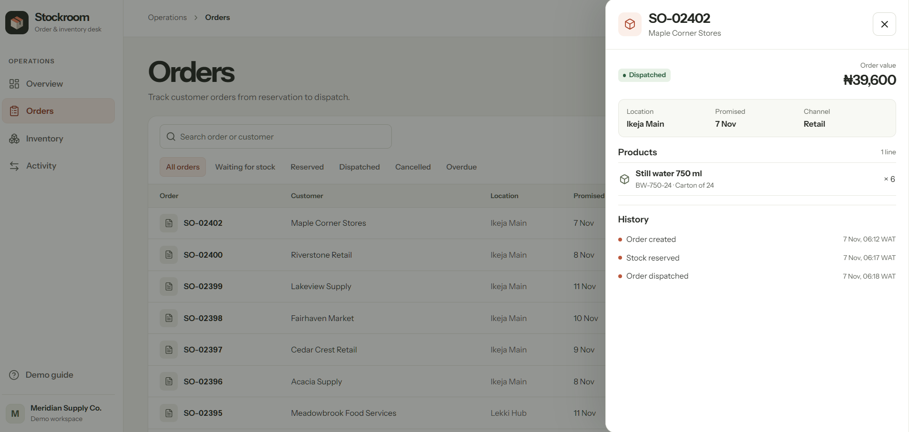
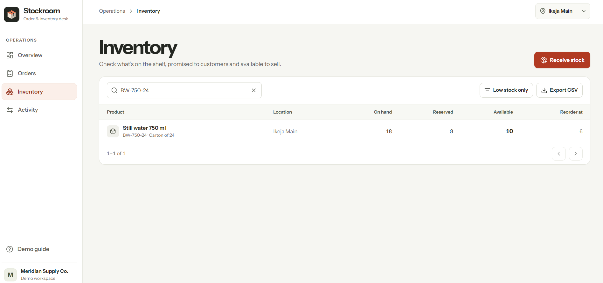
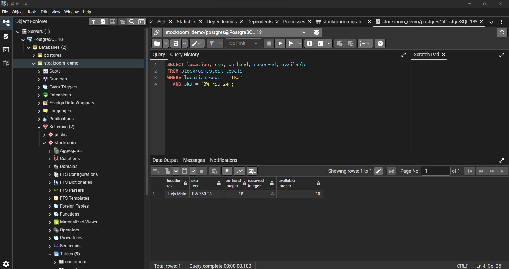
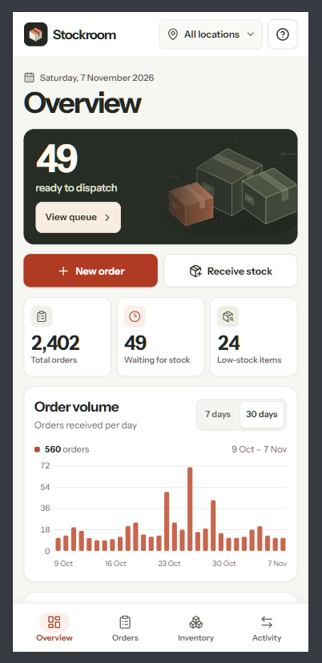

# Stockroom Desk

A warehouse can have stock on the shelf and still be short on a new order because some of that stock is already promised to other customers. Stockroom Desk tracks those commitments by location and gives an operator a record of every receipt, reservation and dispatch.

The demo follows Meridian Supply Co., a fictional Lagos distributor operating from **Ikeja Main** and **Lekki Hub**.

[Run locally](#run-locally) · [Try the demo](#try-the-demo) · [Screenshots](#screenshots) · [Build and test](#build-and-test)



## What the app does

| Screen | What you can do |
| --- | --- |
| **Overview** | Find orders ready to dispatch, see which orders need attention and review 7-day or 30-day order volume. |
| **Orders** | Create an order, check a shortage, reserve stock, dispatch or cancel, and review the order history. |
| **Inventory** | See what is on hand, reserved and available at each location. Receive stock and filter items below or at their reorder point. |
| **Activity** | Search receipts, reservations, dispatches and releases by SKU or reference. Each entry shows the change in stock and when it happened. |

Orders and Inventory also support CSV exports based on the active filters. Order values use Nigerian naira and timestamps use West Africa Time.

## Run locally

The project requires Node.js **22.12 or newer** and a running PostgreSQL server. The demo was tested with **Node.js 24** and **PostgreSQL 18**.

1. Create an empty PostgreSQL database named `stockroom_demo` in pgAdmin or psql.
2. Open a terminal in the project folder. For first-time setup on Windows, copy the example configuration in PowerShell.

   ```powershell
   Copy-Item .env.example .env
   ```

3. In `.env`, set `PGPASSWORD` and match `PGHOST`, `PGPORT`, `PGUSER` and `PGDATABASE` to your PostgreSQL connection. The example uses port `5432` for PostgreSQL and `5173` for the app.
4. Install dependencies, load the schema and sample data, and start the app.

   ```powershell
   npm.cmd ci
   npm.cmd run db:setup
   npm.cmd run dev
   ```

5. Open the address printed in the terminal. [Default local address](http://127.0.0.1:5173)

On macOS or Linux, copy the configuration with `cp .env.example .env` and use `npm` for the commands above.

A fresh database starts with **2,401 orders, 6,001 order lines, 72 products, 180 customers and 11,113 stock movements**. The screenshots include one additional order created during the demo.

## Try the demo

The walkthrough follows **SO-02402**, an order from **Maple Corner Stores** for six cartons of still water (`BW-750-24`) at **Ikeja Main**. The freshly seeded location has four cartons available, so the order starts in **Waiting for stock**.

To reproduce it, select **Ikeja Main** and use **New order** to enter the six-carton order. Use **Receive stock** to add 12 cartons at the same location with the reference `GRN-1028`. Reopen the order, choose **Reserve stock**, then choose **Dispatch order** and **Confirm dispatch**.

| Step | On hand | Reserved | Available |
| --- | ---: | ---: | ---: |
| Six-carton order waiting for stock | 12 | 8 | 4 |
| Receive 12 cartons | 24 | 8 | 16 |
| Reserve six cartons for the order | 24 | 14 | 10 |
| Dispatch the six reserved cartons | 18 | 8 | 10 |

Search `BW-750-24` in **Activity** to trace the receipt, reservation and dispatch. The log records the quantity changed by each event.



### Verify the stock balance in PostgreSQL

Run this query in the `stockroom_demo` Query Tool and compare the result with **Inventory** for the same SKU and location. The repository also includes queries for checking the active database and seeded record counts. [Inspection queries](db/inspect.sql)

```sql
SELECT location, sku, on_hand, reserved, available
FROM stockroom.stock_levels
WHERE location_code = 'IKJ'
  AND sku = 'BW-750-24';
```

## Screenshots

<details>
<summary>Orders list and a separate shortage example</summary>

**Orders list** with status filters, promised dates and order values.



**SO-02400** is a separate order for Riverstone Retail. It calls for six boxes of hibiscus tea (`TE-HIB-12`) at Ikeja Main, where one box is available.



</details>

<details>
<summary>Dispatched order, inventory balance and PostgreSQL check</summary>

**SO-02402** shows the dispatched order and its timestamped history.



**Inventory** shows the stock balance after dispatch.



**pgAdmin** returns the same balance from the `stockroom.stock_levels` view.



</details>

<details>
<summary>Mobile overview</summary>



</details>

## Stock rules

- **Available stock** is calculated as `on_hand - reserved`. PostgreSQL enforces that the reserved quantity stays between zero and the on-hand balance. [SQL schema](db/001_schema.sql)
- **Reservation** checks all items in the order and locks their inventory rows in PostgreSQL. Each stock change, order status update and history entry commits in one transaction. Cancelling a reserved order releases its stock.
- **Order and receipt requests** carry a request ID so a retry can return the original result. [Workflow implementation](server/workflow.mjs)

## Stack and project layout

React and TypeScript power the interface, Vite builds the frontend, and an Express API runs on Node.js with PostgreSQL.

| Path | Contents |
| --- | --- |
| `src/` | Overview, Orders, Inventory, Activity and responsive UI |
| `server/` | API, validation and transactional stock workflows |
| `db/` | PostgreSQL schema, fictional seed data and inspection queries |
| `test/` | Integration tests for order and stock operations |
| `docs/screenshots/` | Desktop, mobile and PostgreSQL screenshots used in this README |

## Build and test

Stop the development server before starting the built app.

```powershell
npm.cmd run build
npm.cmd start
```

For integration tests, create a separate empty PostgreSQL database named `stockroom_test` on the same server. The tests seed and write data in that database. For another run, use a fresh database such as `stockroom_test_second` and set the variable to that name.

```powershell
$env:STOCKROOM_TEST_DATABASE = "stockroom_test"
npm.cmd test
```

On macOS or Linux, run `STOCKROOM_TEST_DATABASE=stockroom_test npm test` against the empty test database.

Stockroom Desk is a local, single-operator demo. Font notices are included with the project. [Font licences](public/licenses/)

Built by **James Isaac**. [Portfolio](https://www.jamesisaac.dev/) · [LinkedIn](https://www.linkedin.com/in/james-bideveloper/)
